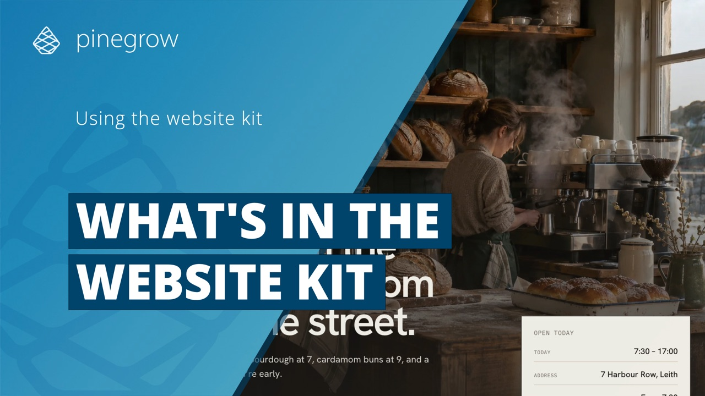
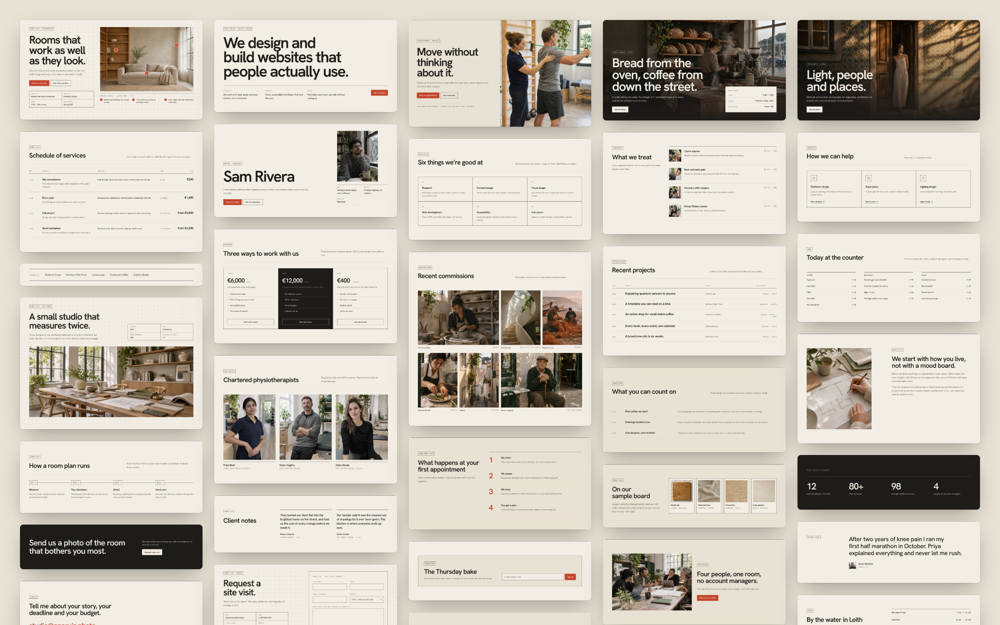
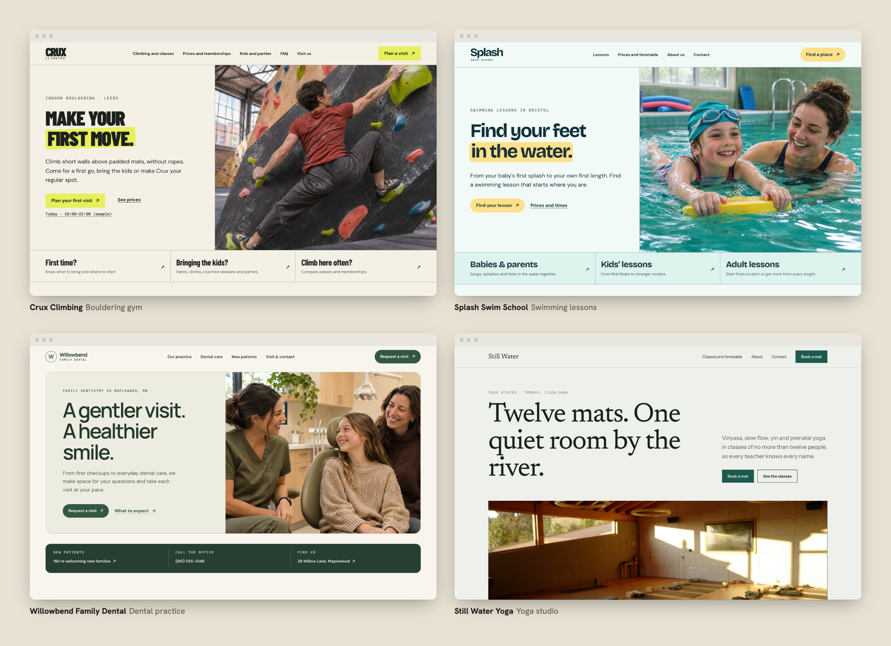
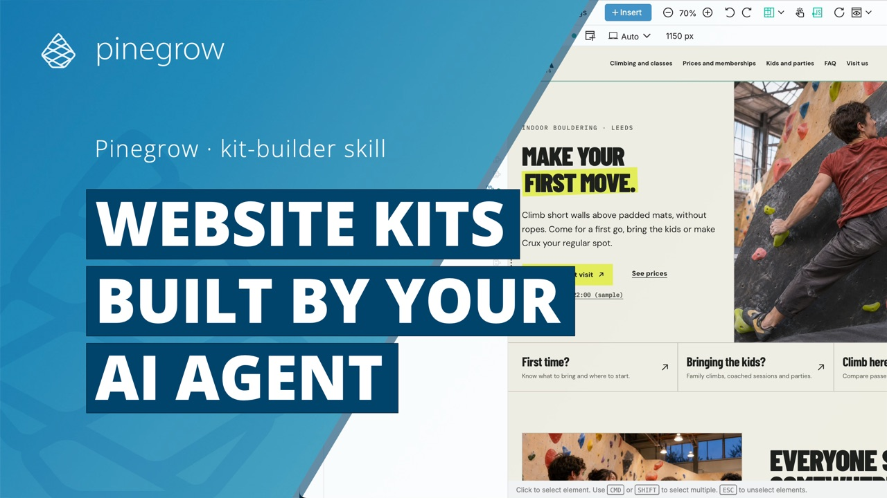

# Pinegrow website kit

A client-ready website kit for Pinegrow 10.1 and later: a complete site, six starter home pages, a library of 40
drag-and-drop blocks and four saved designs, all built with Tailwind CSS. Use it as it is, or as the start of your own
client sites.

It needs Pinegrow 10.1 or later: [download Pinegrow](https://pinegrow.com/download/download-pinegrow-web-editor/),
which starts with a free trial. The [website kit guide](https://cactorial.page/g/pinegrow/website-kit) has short
video lessons for every part, and for building your own kits with an AI agent.

<!-- repo -->

**[Open the live demo](https://pinegrow.github.io/pinegrow-website-kit/website/)**: the complete site, the starter
home pages
([interior design](https://pinegrow.github.io/pinegrow-website-kit/website/index-architecture.html),
[agency](https://pinegrow.github.io/pinegrow-website-kit/website/index-agency.html),
[physio](https://pinegrow.github.io/pinegrow-website-kit/website/index-physio.html),
[café](https://pinegrow.github.io/pinegrow-website-kit/website/index-cafe.html),
[photographer](https://pinegrow.github.io/pinegrow-website-kit/website/index-portfolio.html),
[writer](https://pinegrow.github.io/pinegrow-website-kit/website/index-personal.html))
and the [block library](https://pinegrow.github.io/pinegrow-website-kit/website/blocks/kit-blocks.html), exactly as
they are in the download. The contact form doesn't send on the demo.

**Watch what's in the kit** (1:54), or see [all 18 video lessons](https://cactorial.page/g/pinegrow/website-kit):

### Six starter home pages

Each is a different business, built from the same blocks: an interior design studio, a web agency, a physiotherapy
clinic, a café, a photographer and a writer.

### Four saved designs

One click in Pinegrow's Design panel switches the colors and fonts of every page and block: Linen, Clear, Night and
Pine.

### 40 drag-and-drop blocks

Headers and footers, heroes, services and pricing, work, story and team, testimonials, contact and posts, all in a
block library in Pinegrow's Insert panel.

### Kits built by an AI agent

The `kit-builder` skill in this repository teaches your AI agent to build kits like this one for your own clients
(see "Build your own kits" below). These four were built with it by an AI agent and finished in Pinegrow, each from a
short brief: own designs, component styles, blocks, block library and pages. Their folders in
[`examples/`](examples/) hold the brief (`KIT-BRIEF.md`) and the Pinegrow project.

Live demos:
[Crux Climbing](https://pinegrow.github.io/pinegrow-website-kit/examples/crux-climbing/website/) (a bouldering gym),
[Splash Swim School](https://pinegrow.github.io/pinegrow-website-kit/examples/splash-swim-school/website/),
[Willowbend Family Dental](https://pinegrow.github.io/pinegrow-website-kit/examples/willowbend-dental/website/)
and [Still Water Yoga](https://pinegrow.github.io/pinegrow-website-kit/examples/still-water-yoga/website/).

## Downloads

Get the kit from [Releases](https://github.com/Pinegrow/pinegrow-website-kit/releases) in one of two versions:

- **Static** (`pinegrow-website-kit-<version>-static.zip`): plain HTML pages for any host. Choose this unless you
  build WordPress themes.
- **WordPress** (`pinegrow-website-kit-<version>-wordpress.zip`): the same kit, plus the attributes and templates
  that export it as a WordPress block theme. This repository holds this version.

<!-- /repo -->
<!-- static -->
This is the **static** version: plain HTML pages for any host. A WordPress version with block theme support is a
separate download.

<!-- /static -->
<!-- wordpress -->
This is the **WordPress** version: the pages carry the attributes (`cms-*`) and templates that export the kit as a
WordPress block theme. If you only need a static site, the static version is the same kit without them.

<!-- /wordpress -->
## Video lessons

[Short video lessons](https://cactorial.page/g/pinegrow/website-kit) show every part of the kit, each in one to three minutes. Start with
[What's in the Pinegrow website kit](https://cactorial.page/g/pinegrow/website-kit/what-s-in-the-pinegrow-website-kit-fq7RXxNejsbO) (1:54) and
[Make the kit your own site](https://cactorial.page/g/pinegrow/website-kit/make-the-pinegrow-website-kit-your-own-site-cr6KFYuMdlG9) (1:31). The sections below link to the lesson for each part.

## What's inside

- `website/`: the Pinegrow project. Open this folder in Pinegrow (File › Open project).
- `kit-builder/`: a skill for AI agents (Claude Code, Codex, Cursor...) that builds kits like this one for your own
  clients. See "Build your own kits" below.

### Pages

- **A complete site** for any small business: `index.html`, `about.html`, `contact.html`, `journal.html`, `post.html`
  and `404.html`. The placeholder text says what to write where.
- `index-blank.html`: only the header and footer. Start new pages from it.
- **Starter home pages** for different kinds of business, built from the same blocks:
  - `index-architecture.html`: an interior design studio;
  - `index-agency.html`: a web agency;
  - `index-physio.html`: a physiotherapy clinic;
  - `index-cafe.html`: a café and bakery;
  - `index-portfolio.html`: a photographer's portfolio;
  - `index-personal.html`: a personal site for a writer.

To start a site from a starter instead, save it as `index.html` and delete the starters you don't need.

▶ Watch: [Use a starter home page](https://cactorial.page/g/pinegrow/website-kit/use-a-starter-home-page-in-the-pinegrow-website-ki-RTvmVMr3cCUB) (1:03)

### Header and footer

On the complete site, the header and footer are components. Edit them on `index.html`, then choose Components ›
Update the whole project (⇧⌘U) and File › Save all: every page that uses them changes, including new pages made from
`index-blank.html`.

▶ Watch: [Edit the header and footer on every page](https://cactorial.page/g/pinegrow/website-kit/edit-the-header-and-footer-on-every-page-sQs2WItkUwmX) (1:42)

### Designs

Open the Design panel to switch between the four saved designs: Linen, Clear, Night and Pine. Each design changes
the colors and fonts of every page and block at once. Edit a design, or save your own, in the same panel. The default
Tailwind colors stay available in every design.

▶ Watch: [Switch and edit the saved designs](https://cactorial.page/g/pinegrow/website-kit/switch-and-edit-the-saved-designs-in-the-pinegrow-7QLHLzvl45nr) (1:28)

### Component styles

Buttons, headings, sections, cards and form fields use component styles (`.btn-primary`, `.section`, `.heading-lg`...).
Edit one in the Style panel and every element that uses it changes.

▶ Watch: [Change every button at once with component styles](https://cactorial.page/g/pinegrow/website-kit/change-every-button-at-once-with-component-styles-YZkSZ4asWo4L) (1:22)

### Block library

The blocks are in a page library:

1. Open the Insert panel and click "+".
2. Under the project name, choose `kit-blocks.html`. Pinegrow keeps this tab from now on.
3. Click a category, then drag a block onto your page. The bar at the top of the library leads to the other
   categories and back to "All blocks".

▶ Watch: [Add a page from the block library](https://cactorial.page/g/pinegrow/website-kit/add-a-page-from-the-block-library-pinegrow-website-ME0KabUhMibO) (1:35)

### Content panel

Every block is a group in the Content panel, and repeated items (services, projects, people, questions, prices) can
be added, duplicated and reordered there. Your clients can edit texts and images without touching the design.

▶ Watch: [Edit texts and lists in the Content panel](https://cactorial.page/g/pinegrow/website-kit/edit-texts-and-lists-in-the-content-panel-pinegrow-9P86wR4SIFXA) (1:47)

### Contact form

The contact form works on static hosting: with Netlify Forms when you publish to Netlify, or with a form service such
as Formspree or Web3Forms on any other host. `website/form/README.md` explains the setup.

### Publishing

Publish the site from Pinegrow to any host. The project leaves the block library, the WordPress templates and
`wp-blocks.html` out of the published site, so it has only real pages.

▶ Watch: [Publish the site to Cloudflare Pages](https://cactorial.page/g/pinegrow/website-kit/publish-the-pinegrow-website-kit-to-cloudflare-pag-rrgQcyAfai3O) (2:49)

<!-- wordpress -->
### WordPress

The pages of the complete site and `wp-blocks.html` define WordPress blocks, and `website/templates/` holds the
block theme templates. Use any theme slug in Pinegrow's WordPress theme settings, for example your client's name:
Pinegrow fills it in when it exports the templates. Export the project as a WordPress block theme with Pinegrow's
WordPress features, and every block can be used in the Site Editor.

So that the blocks look the same in the WordPress editor, add two stylesheets in the theme settings, under Blocks
editor stylesheets: `tailwind_theme/tailwind_for_wp_editor.css` (Pinegrow's Tailwind CSS for the editor; Pinegrow
updates it whenever it saves the Tailwind CSS) and `tailwind_theme/wp-editor.css` (the kit's font, colours and link
styles, which come from the page's `<body>` classes on the site).

▶ Watch: [Export the kit as a WordPress block theme](https://cactorial.page/g/pinegrow/website-kit/export-the-website-kit-as-a-wordpress-block-theme-TwDCklN5V0Go) (3:03)
<!-- /wordpress -->

### Images

The photos are in `website/images/` as WebP. Replace them with your own photos at the same names and proportions,
or change them in the Content panel.

## Build your own kits

`kit-builder/` teaches your AI agent how to build a kit like this one for your own business or clients: it asks a
few questions, picks a concept, writes the saved designs, component styles, blocks, block library and pages, gets the
photos, and checks the result. It needs Python 3 and works with Tailwind CSS static sites for now.

Copy the `kit-builder` folder into your agent's skills folder, or tell your agent:

> Read kit-builder/SKILL.md and build me a website kit for <your business>.

Open the kit it makes in Pinegrow to compile the CSS and finish it visually.

Video lessons, with Codex:

- [Your own website kits, built by your AI agent](https://cactorial.page/g/pinegrow/website-kit/your-own-website-kits-built-by-your-ai-agent-p3ydDie6dAcg) (0:31)
- [Install the kit-builder skill](https://cactorial.page/g/pinegrow/website-kit/install-the-kit-builder-skill-in-codex-pinegrow-we-nSptfWcu6fQb) (1:12)
- [Build a website kit for a client](https://cactorial.page/g/pinegrow/website-kit/build-a-website-kit-for-a-client-with-codex-BqKUd84ZiKE5) (2:05)
- [Finish and check a website kit in Pinegrow](https://cactorial.page/g/pinegrow/website-kit/finish-and-check-a-website-kit-in-pinegrow-JmHmpiMO23R8) (2:22)
- [Change a website kit later](https://cactorial.page/g/pinegrow/website-kit/change-a-website-kit-later-with-codex-VVHtrGViiZ7H) (1:36)
- [Use your client's own photos](https://cactorial.page/g/pinegrow/website-kit/use-your-client-s-own-photos-in-a-website-kit-with-xxfYmHB9c3hM) (1:46)
- [Reuse a website kit for your next client](https://cactorial.page/g/pinegrow/website-kit/reuse-a-website-kit-for-your-next-client-with-code-vX3p2K2u08mC) (1:33)
- [Fix Tailwind classes that don't work after your agent's changes](https://cactorial.page/g/pinegrow/website-kit/fix-tailwind-classes-that-don-t-work-after-your-ag-KYPjjwwr8qTk) (1:43)

## License

MIT, see `LICENSE`. Use the kit, its code and its images in your own and your clients' projects.
